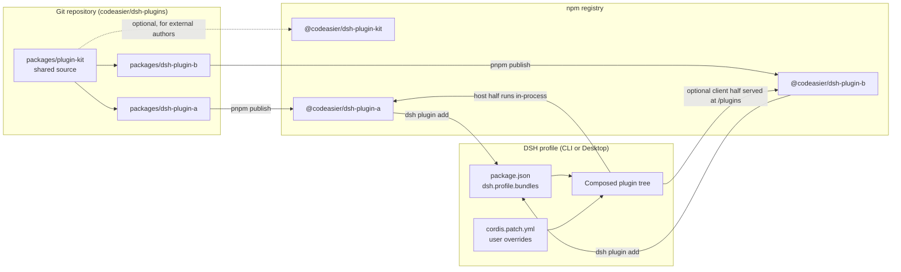
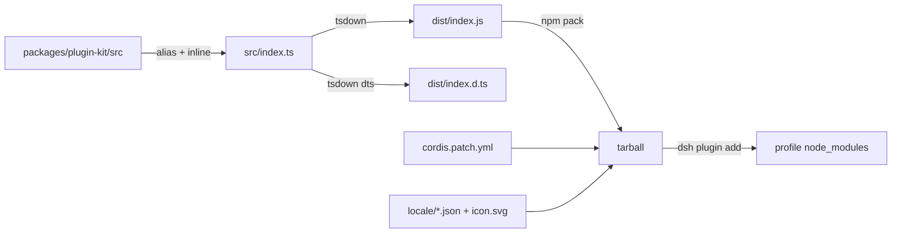

# Architecture

This repository exists to ship **many plugins, each with its own version,
release, and install story**, without duplicating the plumbing that every
plugin needs.

## Design goals

1. **Independent lifecycle.** Adding, updating, or removing one plugin must not
   force a release of any other plugin.
2. **One install unit per plugin.** A user installs an npm package; that
   package carries the host code, the bundle patch, display metadata, and
   optionally a browser half.
3. **Shared code without copy-paste.** Cross-plugin helpers live in one source
   package and are compiled into each plugin.
4. **Machine-checkable conventions.** If a rule matters, a script checks it in
   CI; if a script cannot check it, the rule belongs in review.
5. **No server or build service.** Everything is standard npm, pnpm, and
   GitHub Actions. A plugin remains usable if this repository disappears.

## The three layers

### Layer 1: workspace packages

Every directory under `packages/` is a publishable npm package. There are two
kinds:

| Kind | Declares `dsh.bundle.patch`? | Example | Role |
|---|---|---|---|
| Plugin bundle | yes | `@codeasier/dsh-plugin-hello` | Installs into a profile and inserts one or more Loader rows. |
| Shared library | no | `@codeasier/dsh-plugin-kit` | Compiled into plugins at build time; also publishable for reuse by external authors. |

Plugins are one package each, not subpath exports of one package. That is what
makes independent versioning, changelogs, tags, and installation possible: a
user can install `plugin-a@1.4.0` while `plugin-b` stays on `0.9.2`.

### Layer 2: npm

`pnpm publish` produces a tarball containing only `dist/`, the bundle patch,
locales, the icon, README, and LICENSE. The build inlines the shared kit, so the
manifest lists only published libraries and DSH peers; the registry artifact is
a normal npm package with no dependency on this monorepo.

### Layer 3: DSH profile composition

A DSH profile is a directory under `$DSH_HOME/profiles/<name>/` containing:

- `package.json` — out-of-tree dependencies plus `dsh.profile.bundles`, the
  ordered list of bundle packages to apply;
- `cordis.patch.yml` — the user's own patch layer, applied after every bundle.

Composition starts from an empty tree and applies, in order:

1. each bundle's `dsh.bundle.patch` files, in `dsh.profile.bundles` order;
2. the profile's `cordis.patch.yml`;
3. the home-level `$DSH_HOME/cordis.patch.yml`;
4. any `--patch` overlays on the command line.

A bundle patch **inserts rows**. A profile patch **overrides an existing row by
id**, and a `config` in an override replaces the whole previous `config` rather
than deep-merging it. That is why this repository keeps defaults in the
`Config` schema and keeps the bundle patch free of placeholder config: an
override only has to state what it changes.

Each plugin claims one row id, equal to the package name without the
`@codeasier/dsh-plugin-` prefix (`hello`, not `plugin-hello`). The conventions
check enforces uniqueness across the repository.

### Runtime resolution

DSH builds one immutable module resolution from the installation and the
profile's dependency graph, then installs it into Node's ESM and CommonJS
resolvers. In practice:

- **DSH packages are peers.** `@deepseek-ai/cordis`, `@deepseek-ai/dsh-tools`,
  and friends must resolve to the runtime's copies. A second copy would create
  a different service registry and break injection. This repository declares
  them as `peerDependencies` and never bundles them.
- **Ordinary libraries are dependencies.** `@deepseek-ai/schemastery` is safe
  to install per plugin; a duplicate copy has no shared mutable state.
- **The shared kit is compiled in.** tsdown aliases it to its source and inlines
  it, so it cannot introduce a second service instance. It must stay free of DSH
  services and side effects for the same reason.

This is also why DSH checks `engines.dsh` *before* importing plugin code: an
incompatible plugin must not run at all. See
[Manifest reference § compatibility](manifest-reference.md#compatibility).

## Independent lifecycle

| Change | Releases required | Notes |
|---|---|---|
| Fix one plugin's tool output | that plugin | Patch changeset. |
| Add a tool to one plugin | that plugin | Minor changeset. |
| Change `plugin-kit` additively | kit (optional) + every plugin that should ship it | Each plugin adopts it by rebuilding and releasing. |
| Change `plugin-kit` shape | kit major + every plugin that adopts it | A broken helper is caught by each dependent's tests before release. |
| Narrow `engines.dsh` | the plugins that narrow it | Users on the excluded DSH versions must upgrade DSH first. |
| Add a new plugin | the new package only | `0.1.0`, no changeset needed for the first publish. |
| Change repository CI/docs | none | No npm artifact changes. |

The repository does **not** publish a single "all plugins" package. A
meta-package would couple every install and every release, which defeats the
goal. A user who wants several plugins installs several packages.

## Build pipeline

- **tsdown** bundles each host entry to ESM and emits declarations and source
  maps. The workspace kit is inlined from source; DSH packages and published
  libraries stay external.
- The browser half, when present, is a loader-format artifact served directly
  by DSH; it is not produced by the host build. See
  [Client UI](client-ui.md).
- `npm pack --dry-run` is part of CI, so the published file list is tested
  rather than assumed.

## What this repository deliberately does not do

- Run a plugin server or proxy at runtime.
- Vendor DSH packages or re-export their APIs.
- Patch a user's profile outside `dsh plugin` / the Desktop Plugins page.
- Provide a private registry or an internal build cache.
- Support DSH versions outside the declared `engines.dsh` range. Users can
  force an exact-version exemption; the repository does not recommend it.
